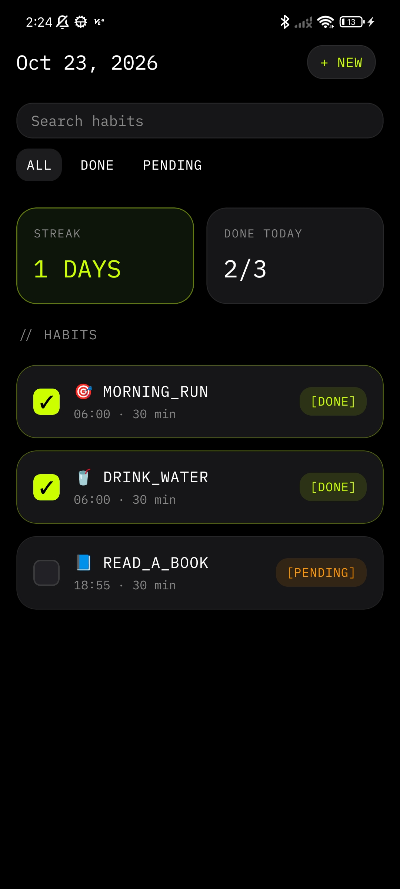
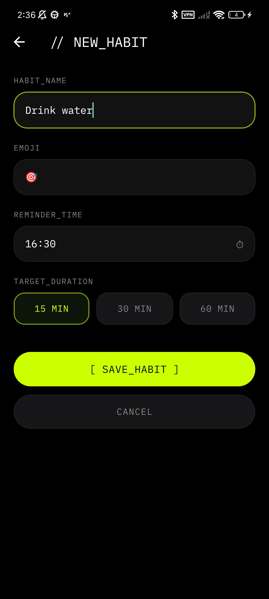
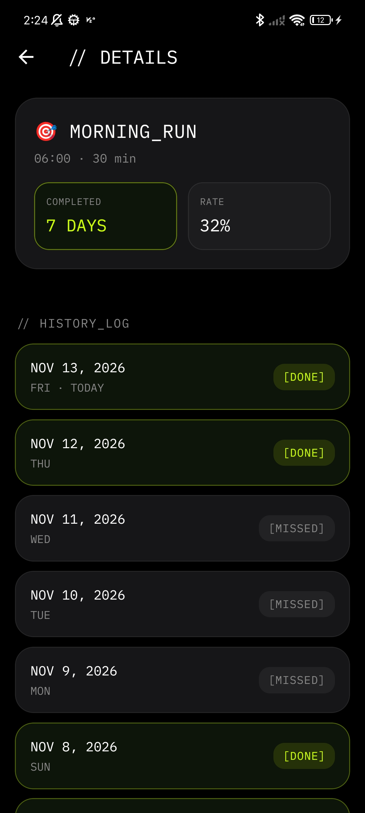
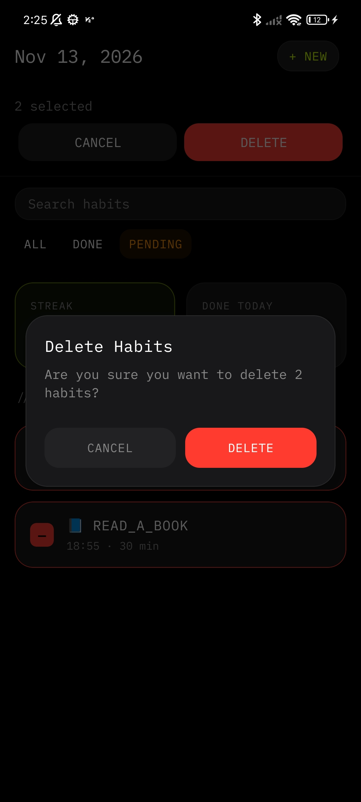

# Habit Tracker (React Native Test Task)

A mobile application to track daily habits, toggle completion, and monitor progress.

## Tech Stack
*   **React Native CLI** (TypeScript)
*   **React Navigation** (Native Stack)
*   **React Native MMKV** (Local storage)
*   **React Native Community DateTimePicker** (Native time picker)

## Implemented Features
*   **Habits List:** Display habits with name, emoji, and today's status. Search and filter (All / Done / Pending).
*   **Add Habit:** Form with name, emoji, time, and duration. Includes duplicate and empty-field validation.
*   **Toggle Status:** Tap to mark as done/pending with instant UI update.
*   **History & Stats:** Detailed screen with a 35-day history log, completion rate, and streak calculation.
*   **Manage Habits:** Bulk delete via long-press selection mode.
*   **Theming:** Automatically follows system light/dark mode.
*   **Edge Cases:** Handled empty states, duplicates, and midnight date rollover.

## How to Run

1. Install dependencies:
```bash
npm install
```

2. (iOS only) Install native pods:
```bash
cd ios && pod install && cd ..
```

3. Start the app:
* For Android: `npm run android`
* For iOS: `npm run ios`

## Screenshots

|                    Home Screen                    |                     Add Habit                     |                  Details & Stats                  | Delete Habits                                     |
|:-------------------------------------------------:|:-------------------------------------------------:|:-------------------------------------------------:|---------------------------------------------------|
|  |  |  |  |

***